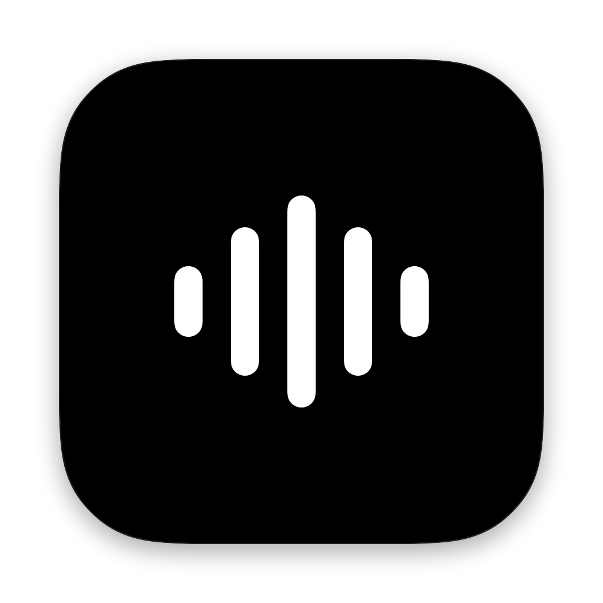
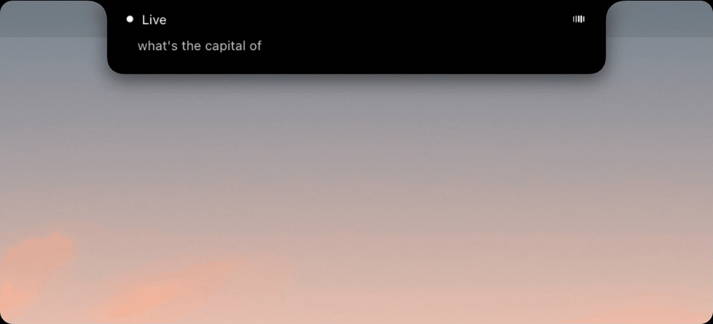
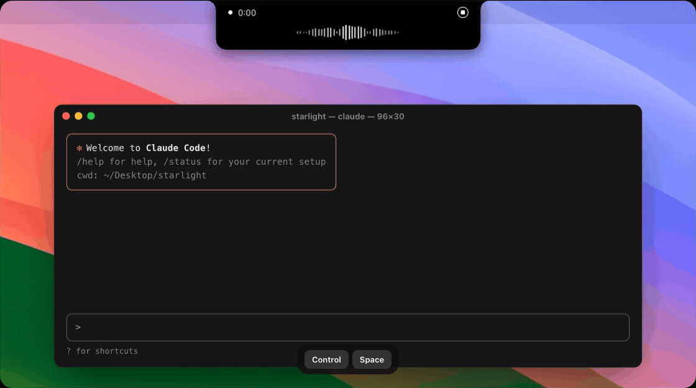
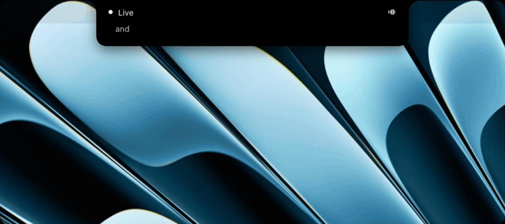
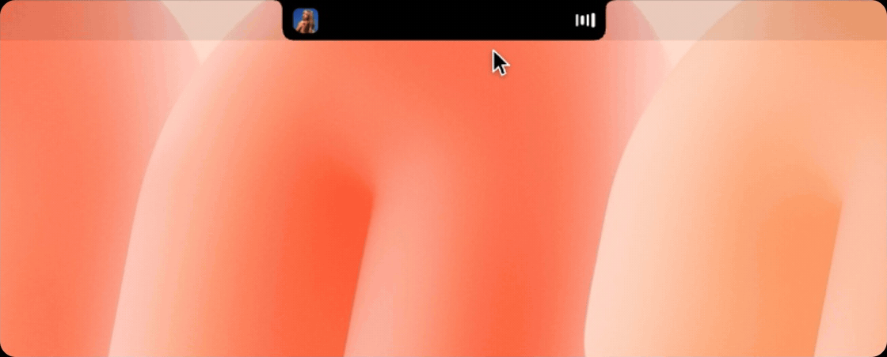
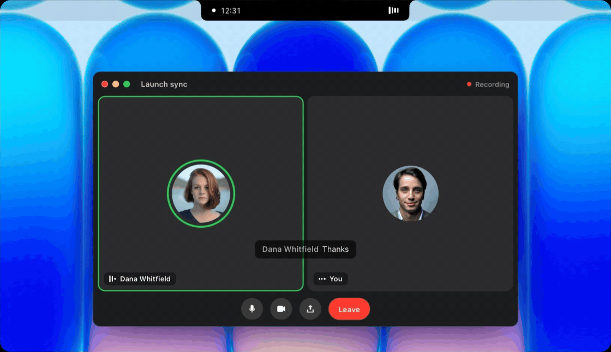

<p align="center">
  
</p>

<h1 align="center">Starlight</h1>

<p align="center">
  <b>Stop typing. Just talk.</b><br>
  Private voice typing and AI, in your Mac's notch. Free and open source.
</p>

<p align="center">
  <a href="https://starlightnotch.com"><b>Download Starlight free</b></a> ·
  <a href="https://starlightnotch.com/pricing">Starlight Pro</a> ·
  <a href="LICENSE">GPL-3.0</a>
</p>

---

<p align="center">
  
</p>

> **Just want the app?** [Download Starlight free at starlightnotch.com](https://starlightnotch.com).
> It's ready to go: signed by Apple, updates itself, nothing to build.
>
> This repository is for tinkerers: the source of Starlight's dictation and Live mode, to read,
> build, change and make your own.

## What it does

### Dictation: press ⌃ Space, talk, press it again

Your words appear wherever you're typing, cleaned up, and on your clipboard too. It all runs on
your Mac: no account, no internet, no limit, and your voice never leaves it.

<p align="center">
  
</p>

### Live mode: press ⌥ Space and talk to your Mac

Ask anything and the answer shows in the notch. Or have it do things: open apps, add reminders,
turn on dark mode, change the volume. Live mode uses the AI you bring (see below).

<p align="center">
  
</p>

### The notch, reimagined

What's playing, your AirPods' battery, and everything above, right where the camera is.

<p align="center">
  
</p>

Both shortcuts can be changed, and each can work as a toggle or as hold-to-talk.

## Build it yourself

You need a Mac with Apple silicon (M1 or later), macOS 14.4 or later, and Xcode's command line
tools (`xcode-select --install`). (Or skip all this and [download the app](https://starlightnotch.com).)

```bash
git clone https://github.com/starlightnotch/starlight.git
cd starlight
./build.sh && open Starlight.app
```

The first build takes a few minutes. When Starlight opens, it walks you through the rest: the
microphone, Accessibility (so it can type for you), and a one-time download of the voice model.

## Bring your own AI

Live mode needs a model. Open Settings → AI provider and pick one:

| Provider | What you need |
|---|---|
| **OpenRouter** | A key from [openrouter.ai/keys](https://openrouter.ai/keys). Any model it has; Claude Haiku by default. Includes web search. |
| **Anthropic** | A key from [console.anthropic.com](https://console.anthropic.com/settings/keys). Any Claude model. Includes web search. |
| **OpenAI** | A key from [platform.openai.com](https://platform.openai.com/api-keys). Any chat model. |
| **Ollama** | [Ollama](https://ollama.com) and a model you've pulled. Runs on your Mac, free, and nothing leaves it. |

Your key is kept in your Mac's Keychain and only ever sent to that provider. You pay them for what
you use; Starlight adds nothing.

## Want more? Get Starlight Pro

Don't want to manage keys? **[Starlight Pro](https://starlightnotch.com/pricing)** has the AI built
in, plus the features that aren't in this version:

<p align="center">
  
</p>

- **Meeting notes:** both sides of every call, written down, with answers as questions come up
- **Tasks and memory:** it keeps your to-dos and remembers what you tell it
- **Web search with any setup:** no provider key needed
- **Updates by themselves,** signed and notarized by Apple

$15 a month, or $12 a month billed yearly, with a free trial.
**[Download Starlight →](https://starlightnotch.com)**

## How it works

- **Speech to text:** Parakeet TDT through FluidAudio, on the Neural Engine
  (`Sources/TranscriptionEngine.swift`).
- **Cleanup:** rules first (`Sources/TextCleaner.swift`), then a small local model, IBM Granite,
  through llama.cpp (`Sources/CleanupModel.swift`).
- **Live mode:** the agent in `Sources/Agent/`, on the provider you pick (`Sources/AIService.swift`).
  Plain commands ("turn on dark mode", "open Spotify") don't need the model at all.
- **Microphone:** `Sources/AudioCapture.swift`. It picks the built-in mic with the lid open, and
  your headset or external mic with it closed.

Models download on first launch into `~/Library/Application Support/FluidAudio` and
`~/Library/Application Support/Starlight/Models`. Your dictation history stays in
`~/Library/Application Support/Starlight/`.

## License

Starlight is free software under the GNU General Public License v3.0: see [LICENSE](LICENSE). The
name and logo aren't covered by it: see [docs/legal/TRADEMARKS.md](docs/legal/TRADEMARKS.md).
Third-party components keep their own licenses
([docs/legal/THIRD_PARTY_NOTICES.md](docs/legal/THIRD_PARTY_NOTICES.md)).
